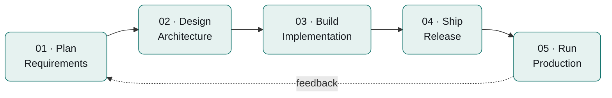

<div align="center">


<a href="https://harold-king-talip.vercel.app">
  
</a>

<br/>

[](https://harold-king-talip.vercel.app)
[](https://www.linkedin.com/in/harold-king-talip-3b7496152/)
[](mailto:hkhighking12@gmail.com)


</div>

---

### 👋 About

Senior Software Engineer with **7+ years** shipping secure, production-grade systems for **fintech, logistics and healthcare**. Backend-first with **Django** and **NestJS**, fluent across the stack with **React** and **Vue**. I own work end to end, from the first requirements meeting to keeping it healthy in production.

<table>
  <tr>
    <td align="center" width="25%"><h2>7+</h2><sub>years in production software</sub></td>
    <td align="center" width="25%"><h2>12</h2><sub>platforms built &amp; shipped</sub></td>
    <td align="center" width="25%"><h2>3</h2><sub>industries: fintech, logistics, health</sub></td>
    <td align="center" width="25%"><h2>Jr → Sr</h2><sub>grown at one company, 2019 – now</sub></td>
  </tr>
</table>

### 🧭 How I work



| | Focus |
|---|---|
| 🔌 **API architecture & integrations** | RESTful services and system-to-system integrations for wallets, disbursements and operations |
| 🗄️ **Data modeling & performance** | Schema design and query optimization where data integrity matters |
| 🛡️ **Security & reliability** | Authentication, role-based access and production support for business-critical systems |

### 🛠️ Featured work

<table>
  <tr>
    <td width="50%" valign="top">
      <b><a href="https://tigomtabai.com/">TigomTaBai</a></b> &nbsp;<br/>
      <sub>PERSONAL FINANCE · AI · 2026 – now</sub><br/><br/>
      Budgeting and expense tracking with AI-powered <b>voice and chat</b> transaction entry in mixed English, Tagalog and Bisaya.<br/><br/>
      <code>Django</code> <code>MySQL</code> <code>Tailwind</code> <code>AI voice + chat</code>
    </td>
    <td width="50%" valign="top">
      <b><a href="https://www.coopnet.online/">Cash Teller Machine</a></b><br/>
      <sub>FINTECH · COOPERATIVES · 2024 – now</sub><br/><br/>
      QR-based, cardless teller platform. Reusable transaction flow on the TraxionPay core API, with <b>message-queue</b> processing for stability.<br/><br/>
      <code>NestJS</code> <code>MS SQL</code> <code>RabbitMQ</code>
    </td>
  </tr>
  <tr>
    <td width="50%" valign="top">
      <b>TraxionPay API</b><br/>
      <sub>FINTECH · PAYMENTS · 2022 – 2024</sub><br/><br/>
      API-driven payment platform for <b>wallets, disbursements</b> and financial operations for businesses, co-ops and institutions.<br/><br/>
      <code>NestJS</code> <code>TypeScript</code> <code>MS SQL</code>
    </td>
    <td width="50%" valign="top">
      <b><a href="https://www.easethetics.kr/">Easethetics</a></b><br/>
      <sub>HEALTHCARE · 2022 – 2024</sub><br/><br/>
      Clinic management for aesthetic and dermatologic clinics: <b>patients, scheduling, billing</b> and reporting, with role-based access.<br/><br/>
      <code>Django</code> <code>DRF</code> <code>Celery</code> <code>MySQL</code>
    </td>
  </tr>
  <tr>
    <td width="50%" valign="top">
      <b>WExpress DRMS &amp; Payroll</b><br/>
      <sub>LOGISTICS · HR · 2021 – 2024</sub><br/><br/>
      Delivery management platform plus an internal payroll system, <b>built from the ground up</b> to production.<br/><br/>
      <code>Django</code> <code>DRF</code> <code>Celery</code> <code>MySQL</code>
    </td>
    <td width="50%" valign="top">
      <b><a href="https://www.digicoop.ph/">DigiCoop</a></b><br/>
      <sub>FINTECH · COOPERATIVES · 2019 – 2023</sub><br/><br/>
      Digital cooperative platform. Built the <b>web admin portal</b> and designed the v2 database schema.<br/><br/>
      <code>Django</code> <code>MySQL</code> <code>MS SQL</code>
    </td>
  </tr>
</table>

### 🧰 Toolkit

<p align="center">
  <br/>
  
</p>

<p align="center">
  <sub>Also: Django REST Framework · Celery · MS SQL Server · TypeORM · Django ORM · Swagger · Jira · ClickUp</sub>
</p>

### 📈 Career path

```
2019 ──── Junior Software Engineer ─────── Traxion Tech Inc.
2021 ──── Mid Software Engineer ────────── Traxion Tech Inc.
2021 ──── Full-Stack Developer (part-time)  Maginnovate Inc.   → 2025
2024 ──── Senior Software Engineer ─────── Traxion Tech Inc.   ● current
```

🎓 **BS Information Technology**, University of Southeastern Philippines (2015 – 2019)

---

<div align="center">

**Does your company need a reliable software developer to improve its operations?**

[](mailto:hkhighking12@gmail.com)
[](https://harold-king-talip.vercel.app)


</div>
